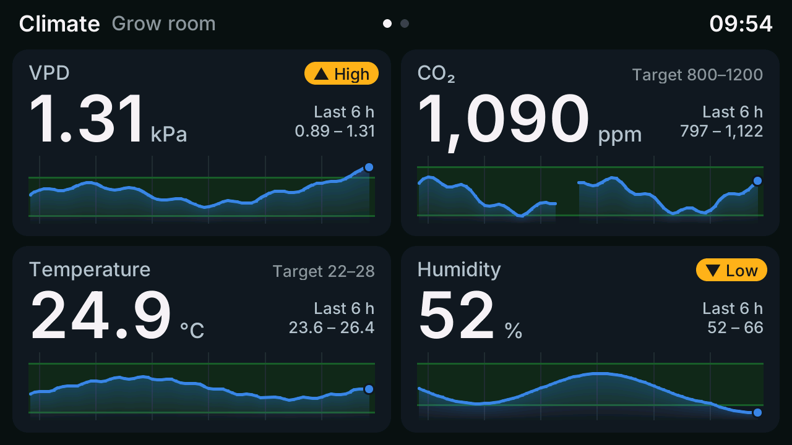
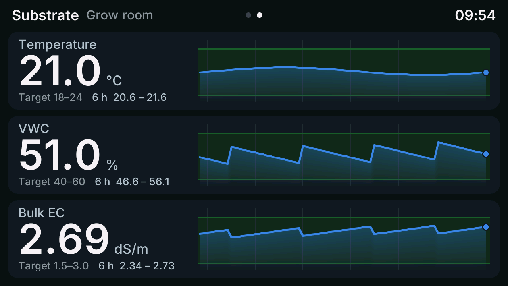
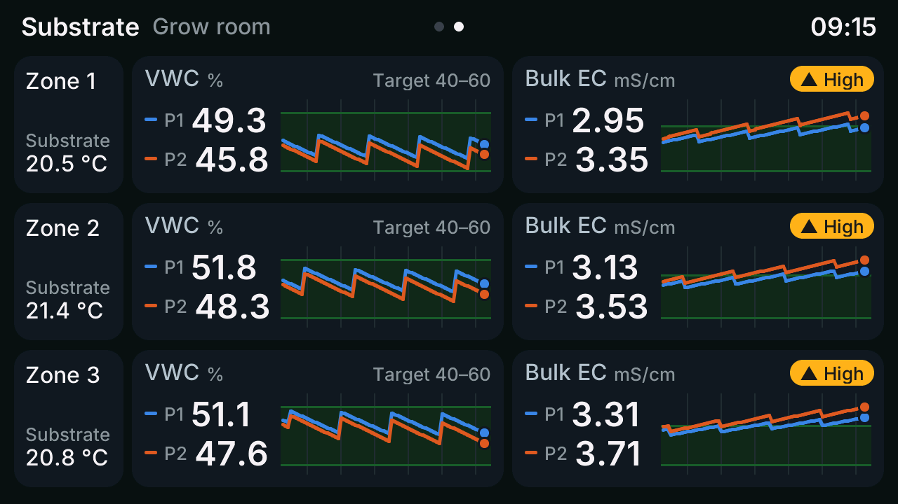

# Tab5 grow dashboard

An [ESPHome](https://esphome.io) dashboard for the [M5Stack Tab5](https://shop.m5stack.com/products/m5stack-tab5-iot-development-kit-esp32-p4)
that shows grow-room conditions from Home Assistant, each value with a 6-hour chart.

The substrate screen comes in two layouts: one probe, or three zones with two probes each.

- **Climate** screen: VPD, CO₂, temperature and humidity.
- **Substrate** screen: temperature, VWC and bulk EC from one probe, or, in the zones layout, each zone's substrate
  temperature plus VWC and bulk EC with both probes' values and a line per probe on one chart.
- Every chart covers 6 hours, with your target range as a green band. Outside the range the tile shows an amber
  **▲ High** or **▼ Low** badge (for a zone, judged on the average of its two probes).
- The charts are filled from Home Assistant's statistics at boot, so they're complete straight after a reboot or update.
- Swipe between the screens. Left alone, they swap every 30 seconds.
- The header shows the time and an **HA offline** badge whenever Home Assistant is disconnected.

> [!NOTE]
> Status: the one-probe layout runs on a Tab5 with the ST7121 panel. The zones layout is new in 0.2. Still pre-1.0;
> the screenshots above were rendered from the configuration with synthetic data.

## What you need

- An M5Stack Tab5 with the ST7121 or ST7123 display controller (later production units). The original
  ILI9881C/GT911 revision isn't supported yet.
- ESPHome 2026.8 or newer.
- Home Assistant 2025.11 or newer, with the sensors you want to show.

## Install

1. In the ESPHome dashboard, create a new device for the Tab5 (or open its existing YAML) and paste in
   [`example.yaml`](example.yaml) for one substrate probe, or [`example-zones.yaml`](example-zones.yaml) for three
   zones with two probes each. Keep the `wifi`, `api` and `ota` blocks ESPHome generated for your device.
2. Point the entity lines at your Home Assistant sensors, and set the target ranges.
3. In Home Assistant, go to **Settings → Devices & services → ESPHome**, open the Tab5's **Configure** dialog and turn
   on **Allow the device to perform Home Assistant actions**. The Tab5 uses this to fetch the chart history.
4. Install. The first install has to be over USB-C; after that it updates over Wi-Fi.

ESPHome downloads the rest from this repository when it compiles: the layout
([`dashboard.yaml`](dashboard.yaml) or [`dashboard-zones.yaml`](dashboard-zones.yaml)), the shared parts in
[`parts/`](parts) and the C++ helpers in [`components/grow_dashboard`](components/grow_dashboard).

## Settings

Set any of these under `substitutions:` in your device YAML. The defaults are at the top of
[`parts/base.yaml`](parts/base.yaml) and the layout file.

| Substitution | Default | What it does |
| --- | --- | --- |
| `name`, `friendly_name` | `m5stack-tab5`, `M5Stack Tab5` | Device name in ESPHome and Home Assistant |
| `room_name` | `Grow room` | Shown in the header |
| `dashboard_ref` | `main` | Release of this repo to use; see [Updating](#updating) |
| `display_model` | `M5STACK-TAB5-ST7121` | `M5STACK-TAB5-ST7123` if your panel has that controller |
| `rotation` | `90` | `270` if the picture is upside down for the way it's mounted |
| `cycle_interval`, `cycle_pause` | `30s`, `3min` | How often the screens swap, once nobody has touched them for `cycle_pause` |
| `cycle_slide` | `OFF` | `ON` to slide between screens when they swap on their own. Swiping by hand always slides |
| `<tile>_entity` | | The Home Assistant sensor for a tile (one-probe layout, and the climate tiles in both) |
| `<tile>_unit` | | Unit shown next to the value (display only) |
| `<tile>_decimals` | | Decimal places |
| `<tile>_low`, `<tile>_high` | | Target range |

`<tile>` is one of `vpd`, `co2`, `temp`, `humidity`, `substrate_temp`, `vwc` or `bulk_ec`.

The zones layout takes these for each zone `N` (1 to 3). Units, decimal places and target ranges come from the
`vwc_*`, `bulk_ec_*` and `substrate_temp_*` settings above and are shared by all zones.

| Substitution | What it does |
| --- | --- |
| `zoneN_name` | Shown on the zone's card |
| `zoneN_vwc_1`, `zoneN_vwc_2` | VWC from probe 1 and probe 2 |
| `zoneN_ec_1`, `zoneN_ec_2` | Bulk EC from probe 1 and probe 2 |
| `zoneN_temp_1`, `zoneN_temp_2` | Substrate temperature from probe 1 and probe 2; the card shows their average |

## How the charts get their history

Each chart holds 72 five-minute averages, lined up with the 5-minute statistics Home Assistant keeps for every
sensor that has a `state_class`. When the Tab5 connects, it calls `recorder.get_statistics` for the last 6 hours,
and a response template trims Home Assistant's reply before it's sent: under 1 KB per sensor, about 15 KB for the
zones layout's 16 charted sensors. After that the Tab5 samples each sensor every 10 seconds while Home Assistant is
connected. If the connection drops, the missing stretch is fetched again at the next time sync, every 15 minutes.

A sensor's chart only fills in from history if Home Assistant keeps statistics for it. Most sensors do; a template
sensor or helper (VPD is often one) may need its **State class** set to **Measurement**, and an ESPHome template or
Modbus sensor needs `state_class: measurement` in its YAML.

## Troubleshooting

- **Charts are empty after every restart, and the log says Home Assistant did not answer the last 3 history
  requests**: the setting in step 3 is off. Turn it on, then restart the Tab5.
- **One chart stays empty after a restart while the others fill in**: that sensor has no statistics in Home Assistant;
  see the paragraph above. The chart still fills from live readings.
- **The picture is upside down**: set `rotation: "270"`.

## Updating

Set `dashboard_ref` to a newer [release](https://github.com/Chill-Division/tab5-grow-dashboard/tags) and install
again. The dashboard and its C++ helpers both follow that one setting, so they always match.

## Credits

The board setup comes from the Tab5 page in [Chill-Division/M5Stack-ESPHome](https://github.com/Chill-Division/M5Stack-ESPHome).
Licensed under the Apache License 2.0.
